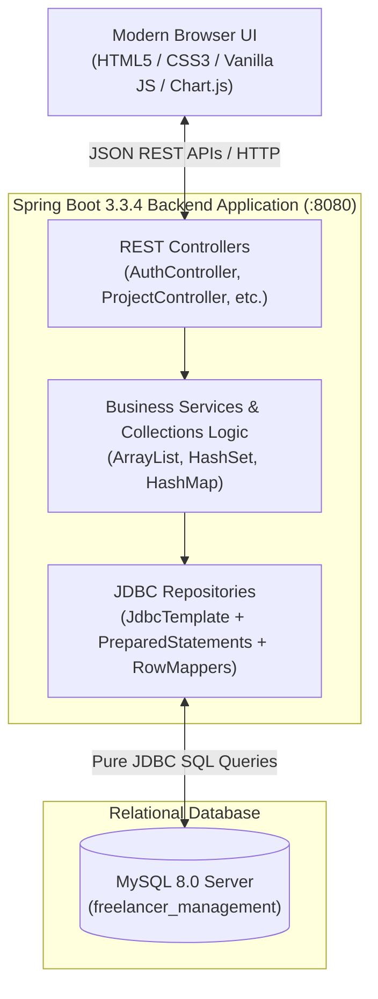
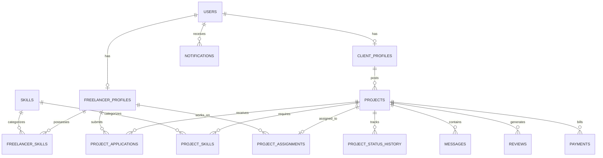

# FreelanceHub — Enterprise Freelancer Project Management System

> **"Connect. Create. Collaborate."**  
> A production-style, full-stack Freelancer Project Management SaaS application built with **Java 17**, **Spring Boot 3.3.4**, **Pure JDBC (`JdbcTemplate`)**, **MySQL 8.0**, and a **Modern Responsive UI** featuring dynamic skill matching, project lifecycle management, real-time messaging, review systems, and administrative analytics.

---

## 🌟 Key Highlights

- **Pure JDBC Data Access Layer**: Engineered completely with Spring's `JdbcTemplate`, custom `RowMapper` implementations, and prepared statements. **No JPA/Hibernate** is used as the primary persistence layer.
- **Demonstrable Java Collections Integration**: Explicit, academic-grade utilization of:
  - `ArrayList` for ordered lists, entity collections, dynamic search filters, and activity timelines.
  - `HashSet` for $O(1)$ duplicate application prevention and set operations (`retainAll`, `removeAll`) in the skill matching engine.
  - `HashMap` for dashboard KPI aggregation, status frequency mappings, category budgeting analytics, and applicant scorecards.
- **Modern SaaS Glassmorphism UI**: Built with responsive Vanilla CSS3, custom design tokens, dark/light theme persistence, dynamic project filtering, visual lifecycle stepper, and interactive Chart.js dashboards.
- **Role-Based Workspaces**: Tailored experiences for **Freelancers**, **Clients**, and **Admins**, complete with a 1-click Demo Account Switcher in the top navigation bar.
- **Production-Ready Resilience**: Includes global REST exception handling (`GlobalExceptionHandler`), SHA-256 salted password hashing (`PasswordUtil`), database constraints against duplicate applications, and automated integration test suites.

---

## 🏗️ System Architecture



### Layered Architecture Breakdown
1. **Controller Layer (`com.freelancehub.controller`)**: Handles incoming HTTP requests, performs parameter validation via Jakarta Validation (`@Valid`), and packages responses into standardized `ApiResponse<T>` wrappers.
2. **Service Layer (`com.freelancehub.service`)**: Implements core business logic, enforces role permissions, manages state transitions, and showcases foundational Java Collections algorithms.
3. **Repository Layer (`com.freelancehub.repository`)**: Interacts directly with MySQL through `JdbcTemplate` without ORM overhead, executing prepared SQL queries and mapping result sets via strongly typed `RowMapper<T>` instances.
4. **Data Layer (`schema.sql` & `data.sql`)**: 12 normalized relational tables with foreign keys, cascading rules, unique composite constraints, and rich seed data.

---

## 🧠 Java Collections Framework Utilization

This project emphasizes clean, intentional usage of core Java collections to solve real-world SaaS problems:

| Collection | Package & Class Usage | Real-World Application in FreelanceHub |
| :--- | :--- | :--- |
| **`ArrayList`** | `ProjectService.java`<br/>`ApplicationService.java`<br/>`FreelancerService.java` | • Returning paginated and filtered lists of projects from JDBC queries.<br/>• Accumulating applicant candidate lists for client evaluation.<br/>• Dynamic collection of project timeline audit events and notification feeds.<br/>• Filtering results using Java Stream collectors into new `ArrayList` instances. |
| **`HashSet`** | `FreelancerService.java`<br/>`ApplicationService.java` | • **Skill Match Engine**: Calculates match percentages using set intersection: `requiredSkills.retainAll(freelancerSkills)` and identifies missing skills with `requiredSkills.removeAll(freelancerSkills)`.<br/>• **Duplicate Prevention**: Fast $O(1)$ in-memory lookups checking if a freelancer has already applied to a project before hitting the database.<br/>• **Tag Extraction**: Collecting unique skill badges across all active marketplace projects. |
| **`HashMap`** | `DashboardService.java`<br/>`AdminController.java`<br/>`ProjectService.java` | • **KPI & Metric Aggregation**: Grouping project counts by status (`DRAFT`, `OPEN`, `ASSIGNED`, `IN_PROGRESS`, etc.).<br/>• **Category Budget Distribution**: Aggregating total budget expenditure across domains (`Web Development`, `Mobile`, `UI/UX`, `DevOps`).<br/>• **Applicant Comparison Matrix**: Mapping applicant IDs to calculated fit scores and hourly rate comparisons.<br/>• **System Health Telemetry**: Key-value telemetry payload for administrative dashboard charts. |

### Code Highlight: Set-Based Skill Matching (`HashSet`)
```java
// Sourced from com.freelancehub.service.FreelanceService.java
Set<String> requiredSet = new HashSet<>(projectSkillNames);
Set<String> freelancerSet = new HashSet<>(freelancerSkillNames);

// Calculate intersection (Matching Skills)
Set<String> matchedSet = new HashSet<>(requiredSet);
matchedSet.retainAll(freelancerSet);

// Calculate difference (Missing Skills)
Set<String> missingSet = new HashSet<>(requiredSet);
missingSet.removeAll(freelancerSet);

// Calculate percentage match
double matchScore = requiredSet.isEmpty() ? 100.0 : 
    ((double) matchedSet.size() / requiredSet.size()) * 100.0;
```

---

## 🗄️ Database Schema & Entities

The database schema is defined in `src/main/resources/schema.sql` and includes 12 normalized relational tables:



### Key Relational Safeguards
- **Duplicate Application Prevention**: `UNIQUE (project_id, freelancer_id)` constraint on `project_applications` guarantees that race conditions or double submissions are rejected at the database level.
- **Lifecycle Integrity**: `project_status_history` audits every phase transition with timestamps and actor IDs (`DRAFT` → `OPEN` → `ASSIGNED` → `IN_PROGRESS` → `UNDER_REVIEW` → `COMPLETED` → `CANCELLED`).
- **Cascade Deletes**: Foreign key dependencies automatically maintain referential integrity when test projects or profiles are removed.

---

## 🚀 Getting Started

### 1. Prerequisites
- **Java Development Kit (JDK) 17** or higher
- **MySQL Server 8.0+** running on `localhost:3306`
- **Apache Maven 3.9+** (or use the included `mvn.cmd` wrapper script)

### 2. Database Configuration
Open MySQL command-line or MySQL Workbench and create the database:
```sql
CREATE DATABASE IF NOT EXISTS freelancer_management;
```

Ensure your credentials in `src/main/resources/application.properties` match your local MySQL configuration:
```properties
spring.datasource.url=jdbc:mysql://localhost:3306/freelancer_management?useSSL=false&allowPublicKeyRetrieval=true&serverTimezone=UTC
spring.datasource.username=root
spring.datasource.password=${DB_PASSWORD:}
spring.sql.init.mode=always
spring.sql.init.schema-locations=classpath:schema.sql
spring.sql.init.data-locations=classpath:data.sql
```
*(Note: Schema DDL and Seed Data DML execute automatically on server startup)*

Set `DB_PASSWORD` in your environment to your local MySQL password before starting the application.

### 3. Run the Backend Server

#### Option A: Running with Maven
```powershell
.\mvn.cmd spring-boot:run
```

#### Option B: Running the Pre-Built Executable JAR
```powershell
java -jar target/freelancehub-1.0.0.jar
```

The server will start on port `8080`.

### 4. Access the Frontend
Open any web browser and navigate to:
```
http://localhost:8080/
```

### 5. Running Automated Integration Tests
The project includes a full unit and integration test suite in `src/test/java/com/freelancehub/FreelanceHubApplicationTests.java`:
```powershell
.\mvn.cmd test
```
All tests verify JDBC queries, duplicate application validation, status state machine progressions, and skill matching arithmetic.

---

## 👥 User Registration, Login & Role Workspaces

The application starts in a **clean, production-ready state** with **0 dummy projects**, **0 dummy freelancers**, and **0 dummy clients**. Users register and populate the platform dynamically through dedicated role-based flows:

### 1. Account Types & Registration
- **Freelancer Registration**:
  - Fill in Name, Email, Password, Professional Headline, Hourly Rate (₹), and Location.
  - **Interactive Skill Chips**: Select technical competencies directly from the 15 pre-seeded skills catalog (`Java`, `Spring Boot`, `React`, `SQL`, `Python`, `Docker`, `AWS`, etc.) or enter custom skills.
- **Client Registration**:
  - Fill in Contact Name, Work Email, Password, Company / Organization Name, Website, Location, and Company Overview.

### 2. Enforced Authentication & Sign In
- **Unregistered Email Protection**: Attempting to sign in with an email that is not yet registered returns a clean error:  
  `"No account found with this email. Please register first!"`
- **Route & Action Guards**:
  - Clicking **"Post a Project"** without an active Client session prompts: *"Please sign in as a Client to post a project, or register first!"* and opens the Client modal.
  - Clicking **"Apply for Project"** without an active Freelancer session prompts: *"Please sign in as a Freelancer to submit a proposal, or register first!"* and opens the Freelancer modal.
  - Navigating to **Dashboard** without signing in redirects to Sign In.

### 3. Administrative Access
- **Platform Administrator**:
  - **Email**: `admin@freelancehub.com`
  - **Password**: `admin123`
  - Provides access to platform-wide telemetry, user moderation, status distribution charts, and category budget analytics.

---

## 📡 REST API Reference

All API responses are wrapped in a standard JSON envelope:
```json
{
  "success": true,
  "message": "Operation completed successfully",
  "data": { ... }
}
```

### Authentication (`/api/auth`)
| Method | Endpoint | Description |
| :--- | :--- | :--- |
| `POST` | `/api/auth/register` | Register a new user (`FREELANCER` or `CLIENT`). |
| `POST` | `/api/auth/login` | Authenticate with email and password; returns user profile and simulated token. |
| `GET` | `/api/auth/me` | Fetch currently authenticated user session. |

### Projects (`/api/projects`)
| Method | Endpoint | Description |
| :--- | :--- | :--- |
| `GET` | `/api/projects` | List all projects with optional query params (`?status=OPEN&category=Web+Development&search=Spring`). |
| `GET` | `/api/projects/{id}` | Retrieve comprehensive project details including required skills and assignment. |
| `POST` | `/api/projects` | Create a new project with required skill IDs and budget (`CLIENT` only). |
| `PUT` | `/api/projects/{id}/status` | Update project lifecycle status (`ASSIGNED`, `IN_PROGRESS`, `UNDER_REVIEW`, `COMPLETED`). |
| `GET` | `/api/projects/client/{clientId}` | Get all projects posted by a specific client. |

### Applications (`/api/applications`)
| Method | Endpoint | Description |
| :--- | :--- | :--- |
| `POST` | `/api/applications` | Apply for a project with proposed rate, duration, and cover letter. |
| `GET` | `/api/applications/project/{projectId}` | Fetch all applicants for a project (includes calculated skill match score). |
| `GET` | `/api/applications/freelancer/{freelancerId}` | Retrieve all applications submitted by a freelancer. |
| `POST` | `/api/applications/{id}/accept` | Accept an applicant, automatically creating a `project_assignment` and changing project status to `ASSIGNED`. |
| `POST` | `/api/applications/{id}/reject` | Reject an application and update notification feed. |

### Freelancers & Skill Match (`/api/freelancers`)
| Method | Endpoint | Description |
| :--- | :--- | :--- |
| `GET` | `/api/freelancers` | List all public freelancer profiles with skill tags and ratings. |
| `GET` | `/api/freelancers/{id}` | Fetch individual freelancer profile details. |
| `GET` | `/api/freelancers/{id}/match/{projectId}` | Compute live matching breakdown (`matchedSkills`, `missingSkills`, `matchPercentage`). |

### Reviews & Ratings (`/api/reviews`)
| Method | Endpoint | Description |
| :--- | :--- | :--- |
| `POST` | `/api/reviews` | Submit a review and rating (1–5 stars) for a completed project. |
| `GET` | `/api/reviews/freelancer/{freelancerId}` | Retrieve all client reviews and aggregate ratings for a freelancer. |

### Project Workspace Messaging (`/api/messages`)
| Method | Endpoint | Description |
| :--- | :--- | :--- |
| `GET` | `/api/messages/project/{projectId}` | Fetch chronological chat messages between client and assigned freelancer. |
| `POST` | `/api/messages` | Post a new message inside the active project workspace. |

### Analytics & Admin Dashboard (`/api/dashboard` & `/api/admin`)
| Method | Endpoint | Description |
| :--- | :--- | :--- |
| `GET` | `/api/dashboard/stats` | Retrieve platform-wide counts: total projects, active freelancers, completed contracts, volume. |
| `GET` | `/api/admin/overview` | Detailed administrative telemetry: status breakdown map, category budget distribution map, and recent audit logs. |

---

## 💻 Tech Stack Summary

```
FreelanceHub
├── Backend: Java 17, Spring Boot 3.3.4 (Web, Validation)
├── Persistence: Spring Framework 6.1 JdbcTemplate (No JPA/Hibernate)
├── Database: MySQL 8.0 Community Server
├── Security: Salted SHA-256 Hashing, Input Sanitization, Role Guards
├── Frontend: Modern HTML5, Responsive CSS3, Vanilla ES6+ JavaScript
├── Visualizations: Chart.js 4.4, Font Awesome 6.4, Google Fonts
└── Testing: JUnit 5, Spring Boot Test, Automated Integration Scripts
```

---

## 📄 License & Attribution
Developed as an enterprise-grade full-stack project demonstrating clean architectural patterns with Spring Boot, pure JDBC, relational database normalization, and modern UI engineering.
